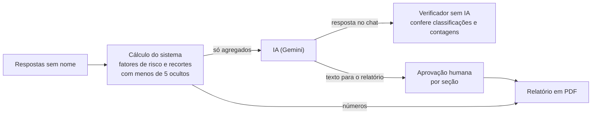

# Soma Vital

Plataforma para empresas avaliarem os riscos psicossociais exigidos pela NR-01, com um assistente de IA que trabalha sobre dados de saúde mental sem ver quem respondeu e sem ter a palavra final sobre os números.
Pré-lançamento, pausado, ainda sem clientes.

O código é privado. Mostro o sistema funcionando numa conversa. O case está em [ednan.page/cases/soma](https://ednan.page/cases/soma/)

## O problema

A atualização da NR-01 obriga as empresas a avaliar riscos psicossociais, como sobrecarga e assédio. Feito à mão, o processo é caro e sujeito a erro, e envolve dados de saúde mental que não podem vazar nem ser ligados a quem respondeu.

O Soma Vital aplica o questionário por link individual, calcula os fatores de risco previstos pelo Ministério do Trabalho, mostra os resultados por setor e gera o relatório em PDF no formato do PGR.

## Onde entra a IA e onde ela para

**O que a IA faz.** Um assistente conversa com o gestor sobre os resultados da campanha e ajuda a montar o plano de ação. A IA também redige o texto interpretativo do relatório, seção por seção.

**O que o assistente recebe.** Só agregados. Ele consulta os dados por ferramentas que eu defini, e essas ferramentas devolvem resultados já com a supressão aplicada: qualquer recorte com menos de 5 respondentes fica oculto. O conteúdo de um recorte suprimido também não vai para a trilha de auditoria.

**Quem calcula os números.** O sistema, não o modelo. A pontuação, a classificação dos fatores e a matriz de risco saem de regras versionadas em YAML, validadas quando a aplicação sobe. O modelo só lê o resultado.

**Como o loop é controlado.** Desliguei a chamada automática de funções do SDK e escrevi o ciclo planejar, chamar ferramenta e observar, com teto de iterações. Assim fica claro quais ferramentas responderam a cada pergunta e existe um ponto fixo para checar a resposta antes de ela sair.

**O verificador.** Antes de a resposta chegar ao gestor, um verificador determinístico, sem LLM, compara a cor do semáforo de risco e a contagem de respondentes que o assistente citou com os dados que as ferramentas devolveram naquele turno.

**Revisão humana antes do relatório.** Nenhum texto da IA entra no PDF sem aprovação do gestor, por seção. A geração do PDF nunca chama o modelo: lê do banco só o texto aprovado. Sem a chave da API, a aplicação sobe em modo degradado e só os recursos de IA deixam de funcionar.

**Comparação antes de fixar o modelo.** Montei uma bateria de avaliação em YAML (perguntas factuais, de privacidade e de inferência) e um comparador que roda o loop real com vários modelos e mede latência. Comparei 3 modelos no mesmo fluxo, e o verificador registrou 0 divergências não corrigidas. O modelo é trocável por variável de ambiente.

## Proteção de dados: decisões e custo

- **Isolamento entre empresas no banco.** O PostgreSQL usa Row Level Security sem ramo permissivo: cada requisição assume um papel sem privilégio e recebe o contexto da empresa. Uma consulta que esqueça o filtro não lê nada, e rota sem empresa responde 403. Custo: toda sessão precisa montar esse contexto, e o comportamento só se prova com testes contra banco real.
- **Resposta sem nome.** A tabela de respostas não tem ligação com o token de quem respondeu, e nome e e-mail ficam numa tabela à parte. Custo: isso não é anonimização total. A linha de resposta guarda setor, cargo, sexo e faixa etária, então a proteção contra reidentificação depende da regra seguinte.
- **Recortes com menos de 5 respondentes ocultos.** Vale para painel, relatórios e dados que o assistente recebe. Custo: setores pequenos nunca aparecem sozinhos.

## Stack

| Camada | Tecnologias |
|---|---|
| Back-end | Python 3.12, FastAPI, SQLAlchemy 2 async, Alembic, Pydantic v2 |
| Banco | PostgreSQL 16 com Row Level Security; Redis 7 só para rascunho de respostas |
| IA | Google Gemini via `google-genai`, loop de ferramentas manual, verificador determinístico |
| Front-end | Next.js 14 (App Router), React, TypeScript, Tailwind |
| Documentos | PDF por HTML e CSS com Chromium headless (Playwright) |
| Infra | Docker, GitHub Actions |

Monólito modular: cada módulo separa domínio, aplicação, infraestrutura e API.

## Limites

- Pré-lançamento e pausado. Não está no ar, não tem clientes, e os dados do repositório são sintéticos.
- O questionário não é um instrumento validado: a validação fatorial de parte dos itens está pendente. O termo de consentimento aguarda revisão jurídica, e o conteúdo do PDF aguarda validação por especialista em NR-01 e SST.
- A proteção de quem responde depende da supressão de recortes pequenos (ver acima).
- A bateria de avaliação do assistente tem ressalvas, sobretudo nas perguntas de inferência.
- Sem RAG, sem fila de mensagens: os eventos rodam em memória, no mesmo processo.

## Origem

O Soma Vital nasceu no AI for Social Impact Hackathon (Google DeepMind e AI Tinkerers SP, abril de 2026). Depois do evento, segui o desenvolvimento e apresentei o projeto no meetup do AI Tinkerers SP, em junho de 2026.

## Links

- Portfólio: [ednan.page](https://ednan.page/)
- Contato: ednanferreira.dev@gmail.com
